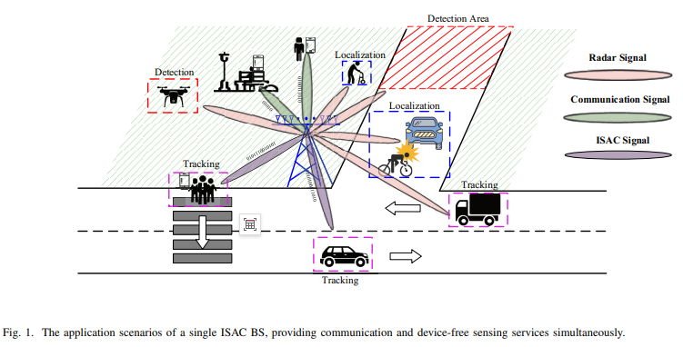
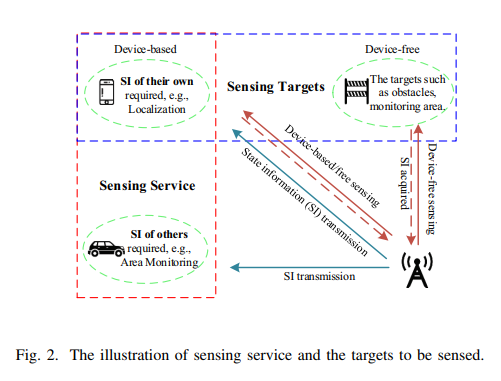
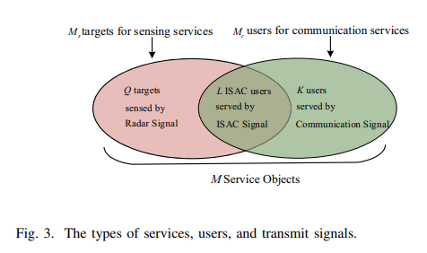
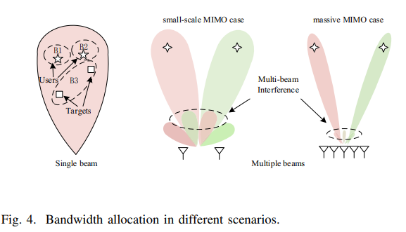
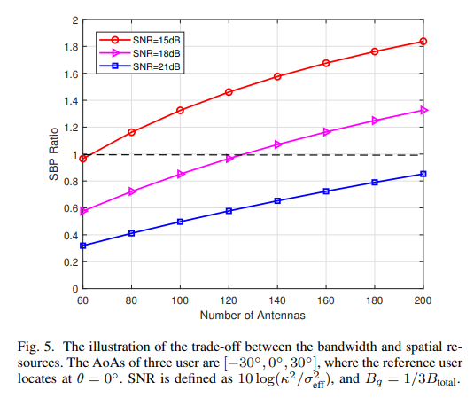
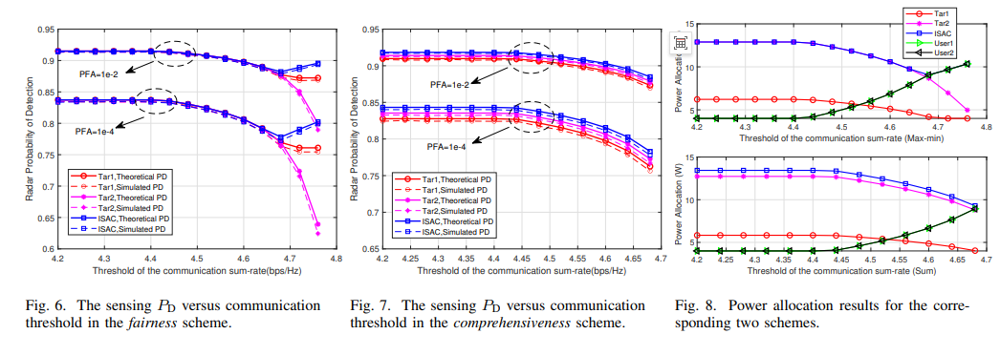
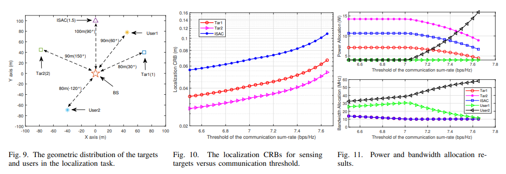
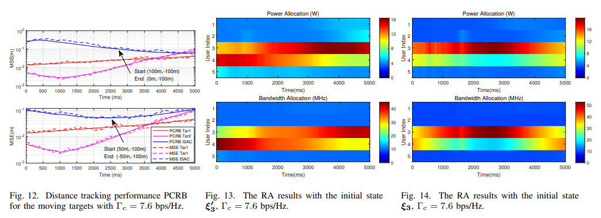
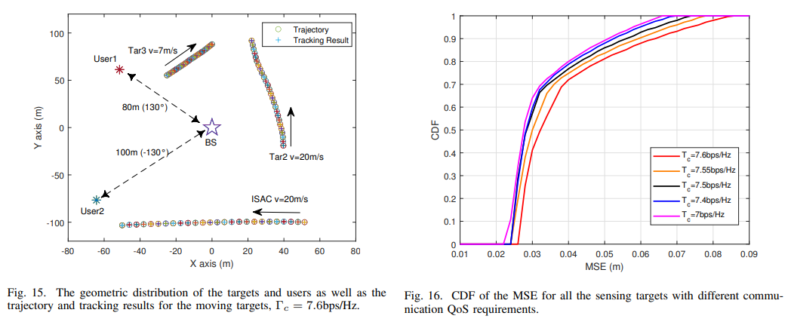

# 6G Integrated Sensing and Communications New Paradigm: When "Perception" Becomes the Fundamental Service of Communication Networks

6G Integrated Sensing New Paradigm: From "Audible" to "Visible", 6G Base Stations are not just communication base stations but also your smart sensing manager. 1. The next key proposition of 6G is if 5G realizes "internet of everything," then 6G is moving towards "intelligent interconnection of everything." In this grand vision, there is a concept that is attracting widespread attention in the academic community - Integrated Sensing and Communications (ISAC).
In simple terms, traditional base stations are solely responsible for "communication"—they send signals to you and you receive them, completing the information transfer. However, within the framework of integrated sensing and communication, the same base station and signal set can not only fulfill the task of communication but also simultaneously perceive the surrounding environment—detecting the position, speed, and angle of targets, akin to a radar.
This idea is not far-fetched. 6G naturally operates in the millimeter wave and even terahertz bands, with a vast signal bandwidth and an extremely large number of antennas, precisely the characteristics that are also required for high-performance radar systems. In other words, the 6G system itself possesses the hardware foundation to become a "super radar."
However, this raises a problem: since communication and perception share the same resources, how should power be distributed? How can bandwidth be allocated? How can we ensure communication quality while maximizing perception capabilities?
The paper we are discussing today, published in IEEE Transactions on Wireless Communications (2023), proposes a comprehensive solution framework around this issue.
II. Core idea: Sensing as a Service (Sensing as a Service) This paper proposes an extremely forward-looking concept - Sensing as a Service, Sensing as a Service.
What does that mean? Let's try to understand it by analogy.
In the 6G perception network, the author envisions a similar scenario: future perceptive capabilities will become a fundamental service of the communication network, where users can "subscribe" to different levels of perceptive services according to their needs. For example:
Drone management: High-precision target detection capability is needed to detect drones invading airspace at any time;
Autonomous driving cars: High-precision target positioning capability is required to precisely know the location of surrounding vehicles;
Low-altitude security systems: High-precision target tracking capability is needed to continuously track the movement trajectory of suspicious flying objects.
These three requirements correspond to the three main tasks of radar perception and precisely constitute the three core modules of this paper.
III. The QoS indicators for the three major perception tasks
The author first made a very crucial work: To define a unified quality of service (QoS) metric standard for different types of perception tasks. Just like in communication, with quantitative indicators, optimization can be discussed.
3.1 Target detection: The question "Is that thing there?" —This is the most basic problem for radar.
Target detection is essentially a binary hypothesis test problem: H₀ hypothesis (no target, only noise) and H₁ hypothesis (target, signal + noise).
The author adopted the classic Neyman-Pearson (NP) criterion to handle this problem: first fix an acceptable false alarm probability (e.g., one in a million), then maximize the detection probability under this premise.
The theoretical formula for the detection probability is based on the non-central chi-square distribution, meaning: the larger the power allocated to the radar target and the better the channel condition, the higher the detection probability —this provides a mathematical foundation for subsequent resource optimization.
3.2 Target positioning: Cramer-Rao lower bound (CRB) "Where is that thing?" —Once the target exists, the next step is to precisely determine its location.
Target positioning involves parameter estimation problems: we need to estimate the target's delay (reflecting distance) and angle (reflecting direction) from the received signal.
Classical estimation theory tells us that the variance of any unbiased estimator cannot be lower than the Cramér-Rao lower bound (CRLB). Therefore, the CRLB naturally becomes the most authoritative theoretical metric for measuring positioning accuracy.
Specifically:
The CRB of time delay estimation is proportional to 1/(power × channel gain × bandwidth) — the greater the power, the wider the bandwidth, the more accurate the ranging.
The CRB of angle estimation is proportional to 1/(Power × Channel Gain) - the greater the power, the more accurate the measurement of angle.
Note a key distinction: Bandwidth only affects range accuracy, not angle accuracy. This physical fact will have subtle effects on subsequent resource allocation.
3.3 Target Tracking: Posterior CRB (PCRB) "Where will it go next?" - This is the most complex question.
Target tracking not only needs to know the current position of the target, but also needs to infer its speed and predict its next moment state. This requires a complete Bayesian filtering framework.
The author adopts **Extended Kalman Filter (EKF)** to achieve tracking. The core idea of EKF is:
1  
Prediction Step: Predict the next moment's position of the target based on its motion model (e.g., constant velocity).
2  
Updating steps: Correct the prediction results with new observation data, the more accurate the observation, the greater contribution it makes to the correction.
Under tracking scenarios, the performance metric is upgraded to Post-CRB (PCRB). The conventional CRB only considers the quality of the current observation, whereas PCRB takes into account two information sources simultaneously.
Prior information: How reliable was your previous prediction of the target state?
Observation Information: How precise is the measurement you made this time?
The two "weighted fusion" results in the final estimation accuracy, which perfectly characterizes the process of "accumulating information" in tracking scenarios.
IV. System Model: A base station, two types of users, and three types of resource understanding the metrics for the three major perception tasks, we will examine how the system operates.
System Configuration: A typical ISAC (Integrated Surveillance, Detection and Communications) base station (BS) is set up, equipped with a large-scale antenna array (32 antennas), operating in the millimeter wave frequency band (30GHz carrier frequency, 100MHz total bandwidth). This BS serves two types of objects simultaneously:
Radar Targets: Objects that need to be perceived (such as vehicles, drones, pedestrians), numbered M;
Communication Users: Terminal devices requiring data communication, numbered K.
Particularly, some entities are both radar targets and communication users—this is known as an "ISAC target," representing the direct manifestation of integrated perception and communication. For example, an autonomous driving car needs to communicate with the base station to obtain traffic information while it itself is also a target that the base station needs to perceive.
Limited Resources: The base station has two allocatable resources:
Total Transmit Power (Pₜₒₜₐₙ): For example, 40 watts;
Total Bandwidth (Bₜₒₜₐₙ): For example, 100MHz.
These resources need to be allocated between radar targets and communication users. The more power allocated to a target, the better its perception or communication effect—but the total resource is limited, directly determining system performance.
Core Contradiction: This is a typical "both-and" problem:
Communication Users need minimum and rate guarantees (you can't compromise on communication quality for perception);
Perception tasks need as high a QoS as possible (detection probability / positioning accuracy / tracking accuracy);
The total resource is fixed, so if you increase one, the other decreases.
The core issue this paper addresses is: How to optimally allocate power and bandwidth under the premise of ensuring basic communication needs, maximizing perception performance?
5.1 Sum Criterion: Maximizing Overall Best
In the context of target detection, the author proposes two optimization strategies, suitable for different application requirements.
5.1 Sum Criterion: Pursuing overall best
The first strategy is to maximize the total signal-to-noise ratio (SNR) of all radar targets. In other words, pursuing the maximum global perception capability.
Specifically, under the joint constraints of total power and communication rate, optimal power allocation between radar targets is carried out to maximize the sum of signal-to-noise ratios for all detected targets.
This is similar to the "utilitarian" approach - maximizing the overall perception ability of the system, without caring about whether individual goals are neglected.
5.2 Max-Min Criterion: Ensuring fairness at the baseline, but sometimes, we are more concerned with "the worst-case scenario." For example, in a multi-objective monitoring scenario, if one objective is "abandon" due to poor channel conditions, it may lead to serious security risks.
At this point, it is necessary to apply the Max-Min fairness criterion: identify the radar target with the poorest perception quality and then strive to improve its quality as much as possible. This can be seen as "addressing the shortcomings" to ensure that each target receives basic perception services.
These two strategies have no absolute good or bad, depending on the actual application scenarios. The paper demonstrates the performance comparison under different strategies through numerical simulation, revealing the classic trade-off between "fairness" and "efficiency".
VI. Joint Resource Optimization Goals for Positioning Tasks
The author of the Alternating Optimization (AO) framework adopted the classic **Alternating Optimization** method:
1  
Fixed Bandwidth, Optimize Power: Assuming the bandwidth allocation for each target is already determined, under the total power constraint and communication constraints, the power is allocated to each target to maximize positioning accuracy.
2  
Fixed power, optimized bandwidth: then in reverse, fixed power allocation, optimized bandwidth allocation;
3  
Iterative until convergence: repeatedly alternate between these two steps, allowing the objective function to improve (or at least not deteriorate) each time, until the result is stable.
Although this method does not guarantee the global optimal solution, it is very practical in engineering: each step is a convex optimization problem that can be solved efficiently, and the iteration process usually converges quickly.
A key physical insight in the positioning task is that bandwidth only improves ranging accuracy, not angular accuracy.
To improve range accuracy → Requires more bandwidth.
To improve the accuracy of angle measurement → More power is needed.
This means that the optimizer needs to dynamically adjust its resource allocation strategy based on the actual requirements of the target (whether it focuses more on distance accuracy or angle accuracy) - allotting more bandwidth to "far-distance targets" may be more meaningful than allotting bandwidth to "near-distance targets" given the same power.
VII. Tracking Task: The art of online resource allocation is the most complex and closest to real-world application scenarios. Its core challenge is that resource allocation must be re-decided at every moment, as the target moves and the channel changes, making previous allocation schemes inapplicable after a while.
EKF + online optimization closed-loop framework entire tracking system workflow is as follows:
1  
State prediction: Based on the position and velocity estimated from the previous moment, predict the possible position of the target at the current moment using a constant velocity model.
2  
Jacobi matrix calculation: Compute the partial derivatives of the measurement equations (distance, radial velocity, azimuth) to quantify the "sensitivity of measurement values to state changes".
3  
PCRB Evaluation: Calculate the current predicted PCRB, assess how uncertain we are about our target state without new observations.
4  
Online resource allocation: re-allocate power and bandwidth to minimize PCRB traces
5  
Kalman Gain Update: Based on new observation information, fuse prior predictive and actual measurement to obtain the optimal state estimation.
This closed-loop process is executed every moment (for example, every 0.5 seconds), achieving the real "seeing while adjusting, and the more adjustments you make, the more accurate it becomes."
The target function for the convex transformation tracking task of non-convex problems in mathematical innovation: Minimizing the trace of PCRB—essentially, it is a non-convex problem that is difficult to solve directly.
A key technical contribution of this paper lies in transforming the originally complex form of the trace (inv(prior matrix + observation increment)) into a summed form of inv_pos(C + D × x), which is supported by CVX (Convex Optimization Toolbox). This transformed problem can be solved efficiently.
This transformation process involves deep matrix analysis theory, but its core idea is very elegant: by insight into the matrix structure, an apparently difficult problem is transformed into a problem that can be easily solved.
What does the simulation experiment reveal? Through extensive numerical simulations, several important conclusions have been drawn:
8.1 The natural trade-off between perception and communication when more power and bandwidth are allocated to the perception task, the communication rate will inevitably decrease. This trade-off is mild within a certain range—although the communication rate is decreasing, the perception performance is significantly improved. However, beyond a critical point, the quality of communication will deteriorate sharply. This reveals an important design principle: the "sweet spot" of resource allocation exists near the turning points on the curves of QoS for perception and communication.
8.2 Fairness comes at a cost in comparison with the Sum criterion and the Max-Min criterion, where the Max-Min ensures the baseline for each objective but overall perception performance will decline. Fairness requires an efficiency cost, a classic conclusion that has been reaffirmed in 6G perception network design.
8.3 Bandwidth is "more precious" than power in positioning and tracking tasks, as bandwidth resources are often scarcer than power resources. This is because bandwidth affects both communication rate and ranging accuracy, while power contributes to ranging and measuring angles. The scarcity of resources determines that the optimizer will distribute bandwidth more cautiously.
In summary, this paper's contributions can be summarized in three sentences:
Unified Framework: The first time, the three major perception tasks of target detection, localization, and tracking are included in the unified ISAC resource allocation framework, providing a theoretical foundation for "Perception as a Service".
2  
Flexible strategy: Two optimization criteria, Sum and Max-Min, are proposed to support different application scenarios for differentiated demands on fairness and efficiency.
3  
Practical algorithms: By employing mathematical techniques such as convex optimization transformation and alternating optimization, complex resource allocation problems can be efficiently solved in real systems.
Looking ahead, the integration of tactile and visual perception will profoundly alter our understanding of communication networks. When every base station possesses the ability to perceive, the "digital nervous system" of smart cities truly takes shape—it can perceive traffic flow, monitor environmental changes, and alert against security threats, all built upon a unified communication infrastructure.
Perception-as-a-service, which was once a concept in science fiction, is now becoming a reality as we approach the 6G era.
References Fuwang Dong, Fan Liu, Yuanhao Cui, Wei Wang, Kaifeng Han, Zhiqin Wang. Sensing as a Service in 6G Perceptive Networks: A Unified Framework for ISAC Resource Allocation. IEEE Transactions on Wireless Communications, 2023, 22(5): 3522-3536.

## Images

<!-- PAYMENT_BLOCK -->

## Get this dataset

- Payment link (Stripe): [Buy now](https://buy.stripe.com/3cs8yP7sY87d0vu9AB)
- Payment QR code: 

<!-- /PAYMENT_BLOCK -->
